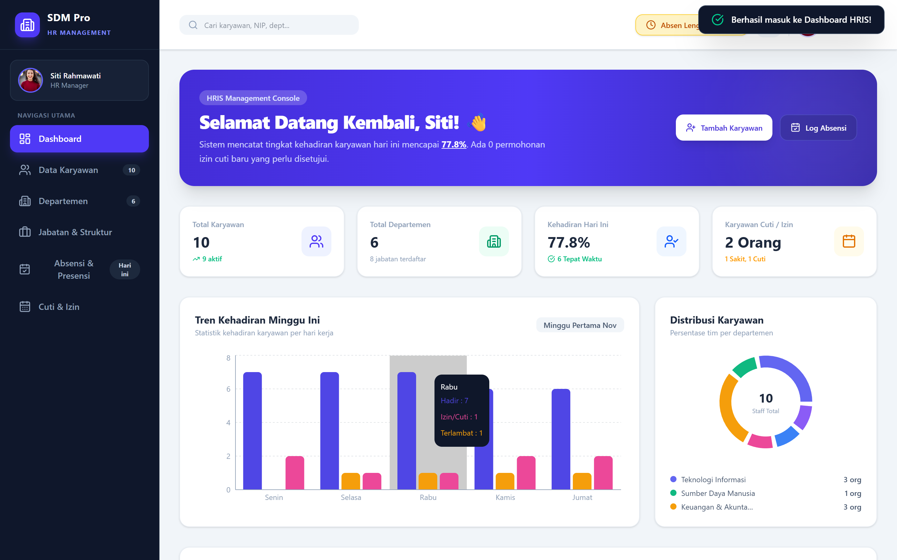
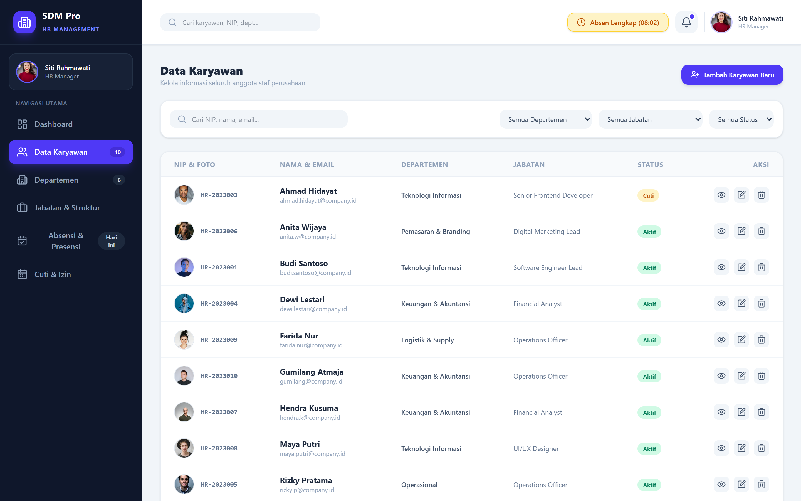
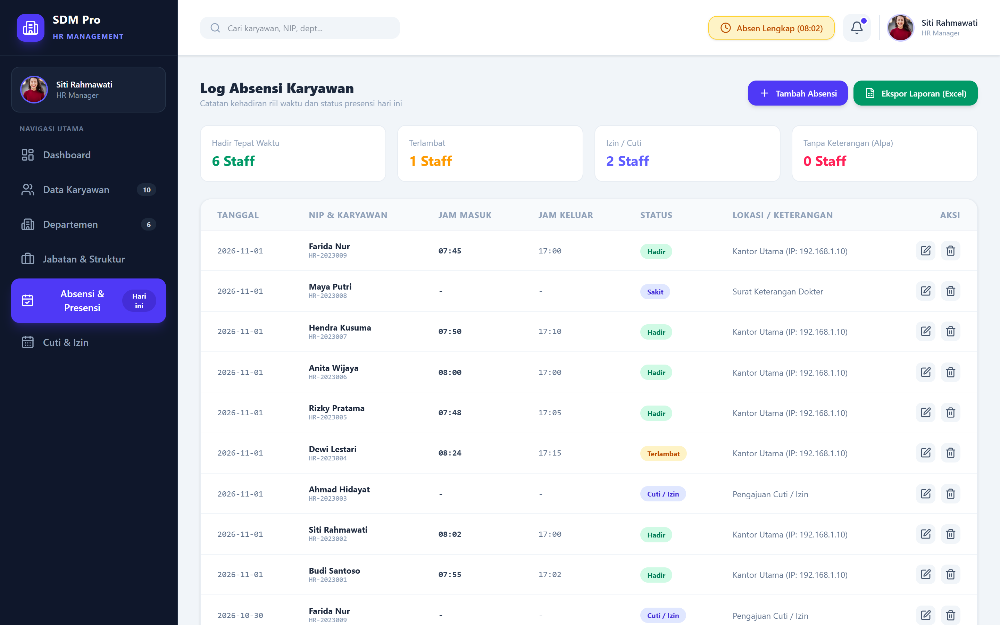
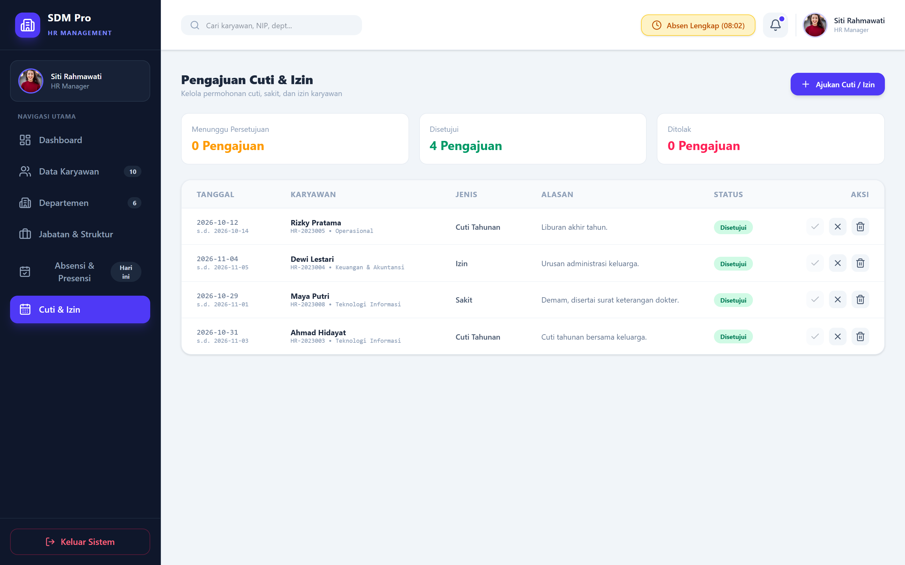
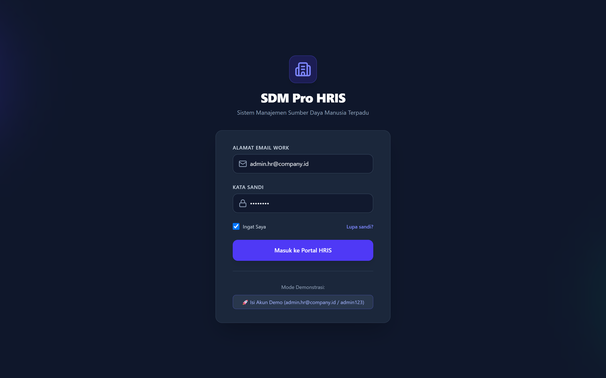
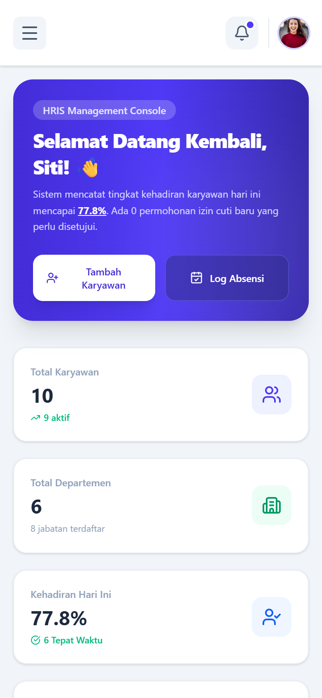

# SDM Pro HRIS

Aplikasi manajemen SDM (**HRIS**) full-stack untuk mengelola karyawan, departemen, jabatan,
absensi, dan cuti — lengkap dengan dashboard analitik dan export laporan Excel.

**Frontend** React 19 + Vite + Tailwind CSS v4 · **Backend** PHP 8 native + SQLite (PDO)


[](https://github.com/Gumiyaa/rdbms/actions/workflows/ci.yml)

Seluruh data (karyawan, departemen, jabatan, absensi, cuti) disimpan di SQLite dan diakses
melalui REST API JSON. Tidak ada data dummy di sisi React — semua angka di dashboard dihitung
dari database.



## Daftar Isi

- [Fitur Utama](#fitur-utama)
- [Tech Stack](#tech-stack)
- [Arsitektur](#arsitektur)
- [Tampilan Aplikasi](#tampilan-aplikasi)
- [1. Cara Menjalankan](#1-cara-menjalankan)
- [2. Struktur Folder](#2-struktur-folder)
- [3. Database](#3-database)
- [4. Daftar Endpoint](#4-daftar-endpoint)
- [5. Detail Fitur Frontend](#5-detail-fitur-frontend)
- [6. Cara Menguji](#6-cara-menguji)
- [7. Catatan Keamanan](#7-catatan-keamanan)
- [8. Perintah npm](#8-perintah-npm)
- [Limitasi & Rencana Pengembangan](#limitasi--rencana-pengembangan)

---

## Fitur Utama

- **Autentikasi & sesi** — login/logout dengan session PHP, password di-hash `password_hash()`.
- **Dashboard analitik** — kartu statistik, bar chart kehadiran mingguan, pie chart distribusi
  departemen, dan tabel aktivitas terkini; semuanya dihitung dari SQLite.
- **Manajemen karyawan** — CRUD lengkap, pencarian & filter **server-side** (departemen,
  jabatan, status) dengan debounce.
- **Departemen & jabatan** — CRUD dengan relasi foreign key dan validasi level jabatan.
- **Absensi** — clock-in/clock-out, rekap kehadiran per karyawan, filter tanggal/status,
  serta tambah/edit/hapus entri.
- **Cuti & izin** — pengajuan cuti, alur persetujuan (setujui/tolak), dan riwayat.
- **Export laporan** — unduh rekap absensi ke **XLSX** dengan filter jabatan.
- **UX lengkap** — loading state, empty state, toast, modal konfirmasi, error banner
  dengan tombol "Coba lagi", dan layout responsif (desktop & mobile).
- **API yang konsisten** — envelope JSON seragam, validasi terpusat, dan pemetaan error
  database ke HTTP status (`409` konflik, `422` validasi, `404`, `405`, `401`).

## Tech Stack

| Layer          | Teknologi                                                        |
| -------------- | ---------------------------------------------------------------- |
| Frontend       | React 19, Vite 8, Tailwind CSS v4, Lucide Icons, Recharts         |
| Backend        | PHP 8.1 native (tanpa framework), PDO                              |
| Database       | SQLite 3 (file-based, di luar web root)                            |
| Export         | SheetJS (`xlsx`)                                                   |
| Pengujian      | Node.js test runner (`node:test`) + PHP CLI, GitHub Actions        |
| Dev environment| Laragon (Apache + PHP)                                             |

## Arsitektur

```
Browser (React 19 SPA)
        │  fetch JSON  /api/*.php
        ▼
Apache + PHP 8 (api/)
        │  PDO prepared statements
        ▼
SQLite  storage/rdbms/employee_management.db
        ▲
        └── schema.php (CREATE IF NOT EXISTS) + seed.php (hanya saat kosong)
```

- Frontend memakai satu `fetch` wrapper (`frontend/src/api/client.js`) dengan `ApiError`
  dan penanganan sesi kedaluwarsa.
- Backend memusatkan auth, validasi, dan serialisasi JSON di `api/helpers.php`.
- Database diinisialisasi otomatis saat request pertama, jadi tidak perlu import SQL manual.

## Tampilan Aplikasi

| Data Karyawan | Absensi & Presensi |
| --- | --- |
|  |  |

| Cuti & Izin | Halaman Login |
| --- | --- |
|  |  |

<p align="center">
  
  <br>
  <sub>Tampilan responsif di layar mobile</sub>
</p>

> Dokumentasi struktur tabel & relasi lengkap ada di **[docs/ERD.md](docs/ERD.md)**.

---

<details>
<summary><strong>📖 Dokumen Lengkap</strong> — Cara Menjalankan, Struktur Folder, Database, Endpoint, Keamanan & lainnya</summary>

## 1. Cara Menjalankan

Prasyarat: **PHP 8.1+** dengan ekstensi `pdo_sqlite`, **Apache** (Laragon), dan **Node.js 18+**.

### Mode development (hot reload)

```bash
npm install      # cukup sekali
npm run dev
```

Buka `http://localhost:5173`. Vite mem-proxy setiap request `/api/*` ke `http://rdbms.test`,
jadi frontend dev memakai backend PHP yang sama dengan mode produksi.

### Mode produksi di Laragon

```bash
npm run build
```

Perintah ini:
1. mem-build aplikasi ke folder `dist/`
2. menyalin hasil build ke root proyek (`index.html`, `assets/`, `favicon.svg`)

lalu buka **http://rdbms.test**.

> `scripts/publish.mjs` tidak pernah menghapus folder `api/`, `storage/`, `scripts/`,
> `frontend/`, maupun `node_modules/` — folder tersebut masuk daftar `PROTECTED`.

### Akun demo

| Email                  | Password   | Peran      |
| ---------------------- | ---------- | ---------- |
| `admin.hr@company.id`  | `admin123` | HR Manager |

Halaman login juga punya tombol **"Isi Akun Demo"** yang hanya mengisi kolom form
(bukan bypass autentikasi). Password disimpan sebagai hash `password_hash()`.

---

## 2. Struktur Folder

```
rdbms/
├── frontend/                    # source React (Vite root)
│   ├── index.html
│   └── src/
│       ├── main.jsx             # bootstrap React
│       ├── App.jsx              # komposisi layout + state & handler
│       ├── index.css            # Tailwind + animasi
│       ├── constants.js         # konstanta bersama (akun demo, data kosong)
│       ├── api/client.js        # fetch wrapper (ApiError + objek `api`)
│       ├── hooks/
│       │   ├── useHrData.js     # data layer: loader, filter, ekspor, error
│       │   └── useToast.js      # notifikasi toast global
│       ├── utils/format.js      # errorText + format IDR
│       └── components/
│           ├── AuthLoading.jsx
│           ├── LoginPage.jsx
│           ├── layout/          # Sidebar & Header
│           ├── pages/           # Dashboard, Karyawan, Departemen, Jabatan, Absensi, Cuti
│           ├── modals/          # 7 dialog form & konfirmasi
│           └── ui/              # ErrorBanner, Toast, TableStates, ModalError
├── api/                         # backend PHP Native
│   ├── config/database.php      # koneksi PDO, init skema, seed otomatis
│   ├── config/schema.php        # definisi tabel & index
│   ├── config/seed.php          # data awal (hanya jika tabel employees kosong)
│   ├── helpers.php              # JSON envelope, auth, validasi, mapper
│   ├── auth.php                 # login / logout / cek sesi
│   ├── employees.php
│   ├── departments.php
│   ├── positions.php
│   ├── attendances.php
│   ├── leave_requests.php
│   ├── dashboard.php
│   ├── .htaccess                # Options -Indexes
│   └── config/.htaccess         # blokir akses langsung ke folder config
├── tests/                       # tes otomatis (tanpa framework tambahan)
│   ├── harness/                 # resolver PHP, spawn `php -S`, klien cookie
│   ├── unit/                    # unit test JS + jembatan PHP CLI
│   ├── api/                     # integration test REST API
│   └── run-api.mjs              # orkestrator tes API + database sementara
├── scripts/
│   ├── publish.mjs              # salin dist/ -> root setelah build
│   └── api-smoke-test.ps1       # smoke test manual (opsional)
├── docs/
│   ├── ERD.md                   # entity relationship diagram & penjelasan relasi
│   └── screenshots/             # tangkapan layar untuk dokumentasi
├── .github/workflows/ci.yml     # pipeline build + unit + integration test
├── vite.config.js               # proxy /api -> http://rdbms.test
├── package.json
│
├── index.html                   # HASIL BUILD (auto-generate)
├── assets/                      # HASIL BUILD (auto-generate)
└── dist/                        # output sementara Vite
```

Database **tidak** berada di web root:

```
D:\Program\Laragon\storage\rdbms\employee_management.db
```

Folder `storage/rdbms/` dibuat otomatis oleh backend, sehingga file `.db` tidak bisa
diakses lewat browser.

---

## 3. Database

### Inisialisasi otomatis

`api/config/database.php` akan:
1. membuat folder `D:\Program\Laragon\storage\rdbms\` bila belum ada,
2. menjalankan `schema.php` (semua statement `CREATE ... IF NOT EXISTS`, aman diulang),
3. mengisi data awal lewat `seed.php` **hanya jika tabel `employees` masih kosong**,
4. mengaktifkan `PRAGMA foreign_keys = ON` pada setiap koneksi.

Data lama tidak pernah dihapus saat aplikasi dijalankan ulang.

### Tabel & relasi

| Tabel            | Kolom penting                                                                 |
| ---------------- | ----------------------------------------------------------------------------- |
| `departments`    | `id` PK, `code` UNIQUE, `name` UNIQUE, `head_id` FK→`employees.id`, `budget`   |
| `positions`      | `id` PK, `code` UNIQUE, `name` UNIQUE, `level` CHECK, `salary_min/max`         |
| `employees`      | `id` PK, `nip` UNIQUE, `email` UNIQUE, `department_id` FK, `position_id` FK, `status` CHECK, `join_date` |
| `users`          | `id` PK, `employee_id` UNIQUE FK→`employees.id`, `email` UNIQUE, `password_hash` |
| `attendances`    | `id` PK, `employee_id` FK, `date`, `check_in`, `check_out`, `status` CHECK, UNIQUE(`employee_id`,`date`) |
| `leave_requests` | `id` PK, `employee_id` FK, `type` CHECK, `start_date`, `end_date`, `status` CHECK, `reviewed_by` FK→`users.id` |

Perilaku foreign key:

- `employees.department_id`, `employees.position_id` → **ON DELETE SET NULL**
- `departments.head_id`, `users.employee_id`, `leave_requests.reviewed_by` → **ON DELETE SET NULL**
- `attendances.employee_id`, `leave_requests.employee_id` → **ON DELETE CASCADE**

Index tambahan dibuat untuk kolom yang sering difilter: `department_id`, `position_id`,
`attendances.date`, `attendances.employee_id`, `leave_requests.status`, `leave_requests.employee_id`.

Diagram lengkap: **[docs/ERD.md](docs/ERD.md)**.

---

## 4. Daftar Endpoint

Semua endpoint mengembalikan JSON dengan envelope:

```json
{ "success": true, "data": ..., "meta": ... }
{ "success": false, "message": "...", "errors": { "field": "..." } }
```

Semua endpoint **wajib login** (session PHP) kecuali `auth.php`. Status yang dipakai:
`200` sukses, `400` body/format tidak valid, `401` belum login, `404` tidak ditemukan,
`405` method salah, `409` konflik data (UNIQUE / masih dipakai), `422` validasi field gagal,
`500` error server (pesan DB tidak dibocorkan).

### Autentikasi

| Method | Endpoint                       | Keterangan                          |
| ------ | ------------------------------ | ----------------------------------- |
| GET    | `/api/auth.php?action=me`      | user aktif + absensi hari ini       |
| POST   | `/api/auth.php?action=login`   | `{ email, password }`               |
| POST   | `/api/auth.php?action=logout`  | hapus sesi                          |

### Karyawan

| Method | Endpoint                                  | Keterangan |
| ------ | ----------------------------------------- | ---------- |
| GET    | `/api/employees.php`                      | filter `q`, `department_id`, `position_id`, `status` |
| GET    | `/api/employees.php?id=1`                 | detail     |
| POST   | `/api/employees.php`                      | tambah     |
| PUT    | `/api/employees.php?id=1`                 | ubah       |
| DELETE | `/api/employees.php?id=1`                 | hapus      |

### Departemen

| Method | Endpoint                        |
| ------ | ------------------------------- |
| GET    | `/api/departments.php`          |
| GET    | `/api/departments.php?id=1`     |
| POST   | `/api/departments.php`          |
| PUT    | `/api/departments.php?id=1`     |
| DELETE | `/api/departments.php?id=1`     |

### Jabatan

| Method | Endpoint                      |
| ------ | ----------------------------- |
| GET    | `/api/positions.php`          |
| GET    | `/api/positions.php?id=1`     |
| POST   | `/api/positions.php`          |
| PUT    | `/api/positions.php?id=1`     |
| DELETE | `/api/positions.php?id=1`     |

### Absensi

| Method | Endpoint                                   | Keterangan |
| ------ | ------------------------------------------ | ---------- |
| GET    | `/api/attendances.php`                     | filter `employee_id`, `date`, `from`, `to`, `status`, `limit`; `meta.summary` berisi rekap |
| GET    | `/api/attendances.php?action=recap`        | rekap kehadiran per karyawan |
| POST   | `/api/attendances.php`                     | tambah absensi |
| POST   | `/api/attendances.php?action=clock-in`     | absen masuk user login |
| POST   | `/api/attendances.php?action=clock-out`    | absen keluar user login |
| PUT    | `/api/attendances.php?id=1`                | ubah |
| DELETE | `/api/attendances.php?id=1`                | hapus |

### Cuti & Izin

| Method | Endpoint                            | Keterangan |
| ------ | ----------------------------------- | ---------- |
| GET    | `/api/leave_requests.php`           | filter `status`, `employee_id` |
| GET    | `/api/leave_requests.php?id=1`      | detail |
| POST   | `/api/leave_requests.php`           | ajukan cuti |
| PUT    | `/api/leave_requests.php?id=1`      | ubah data / status (`pending` / `approved` / `rejected`) |
| DELETE | `/api/leave_requests.php?id=1`      | hapus |

### Dashboard

| Method | Endpoint               | Keterangan |
| ------ | ---------------------- | ---------- |
| GET    | `/api/dashboard.php`   | total karyawan/departemen/jabatan, kehadiran hari ini, grafik mingguan, distribusi departemen, aktivitas terkini — semua dihitung dari SQLite |

---

## 5. Detail Fitur Frontend

- Login/logout dengan session PHP; state aplikasi dimuat ulang setelah login.
- Dashboard: kartu statistik, bar chart kehadiran mingguan, pie chart distribusi departemen,
  tabel aktivitas terkini — datanya dari `/api/dashboard.php`.
- Data karyawan: pencarian & filter **server-side** (debounce 300 ms), tambah, edit, detail, hapus.
- Departemen & jabatan: tambah, edit, hapus.
- Absensi: ringkasan status, log presensi, tambah/edit/hapus, tombol absen masuk/keluar.
- Cuti & Izin: ajukan cuti, ubah status (setujui/tolak), hapus, riwayat.
- Loading state, error banner + tombol "Coba lagi", empty state, toast, modal konfirmasi hapus.
- Setiap mutasi memuat ulang data terkait (tabel, dashboard, grafik).

---

## 6. Cara Menguji

### Tes otomatis

Pengujian memakai **Node.js built-in test runner** (`node:test`) dan **PHP CLI**, tanpa
framework tambahan. Ada dua lapis:

| Perintah            | Cakupan |
| ------------------- | ------- |
| `npm run test:unit` | fungsi murni `api/helpers.php` (format/parse anggaran, validasi tanggal & jam, mapper) lewat PHP CLI, plus helper frontend (`errorText`, `formatIDR`) |
| `npm run test:api`  | integration test REST API: auth & sesi, CRUD karyawan/departemen/jabatan/absensi/cuti, filter, rekap, clock-in/out, dashboard, dan keamanan |
| `npm test`          | menjalankan unit lalu integration test |

Prasyarat: **PHP 8.1+** dengan ekstensi `pdo_sqlite`, `sqlite3`, `mbstring`, dan **Node.js 18+**.
Binary PHP dicari dari `PHP_BINARY`, lalu `php` di PATH, lalu instalasi Laragon.

```bash
npm install        # cukup sekali
npm test
```

### Isolasi database

`npm run test:api` **tidak menyentuh database utama**. Orkestrator `tests/run-api.mjs`:

1. membuat folder sementara (`os.tmpdir()/rdbms-api-*`),
2. membuat database SQLite baru + skema + seed di folder itu (`RDBMS_DB_PATH`),
3. menjalankan `php -S` dengan database dan `session.save_path` sementara,
4. menjalankan `tests/api/*.test.mjs` secara berurutan (server PHP single-threaded),
5. mematikan server dan menghapus folder sementara, termasuk saat tes gagal.

Data yang dibuat tes selalu dihapus di `after()`, dan data seed yang diubah dipulihkan,
sehingga tes dapat diulang tanpa bergantung pada urutan. Untuk men-debug, folder sementara
bisa dipertahankan:

```bash
node tests/run-api.mjs --keep
```

Pipeline yang sama dijalankan otomatis oleh GitHub Actions (`.github/workflows/ci.yml`)
pada setiap push/PR ke `main`: build Vite, unit test, dan integration test API.

> Skrip lama `scripts/api-smoke-test.ps1` tetap tersedia sebagai smoke test manual
> terhadap server Laragon.

### Uji manual cepat

```powershell
# tanpa sesi -> 401
curl.exe -i "http://rdbms.test/api/auth.php?action=me"

# login -> simpan cookie di $session
$body = @{ email = 'admin.hr@company.id'; password = 'admin123' } | ConvertTo-Json
Invoke-RestMethod -Method Post -Uri "http://rdbms.test/api/auth.php?action=login" `
  -ContentType 'application/json' -Body $body -SessionVariable session

# dashboard dengan sesi -> 200
Invoke-RestMethod -Uri "http://rdbms.test/api/dashboard.php" -WebSession $session
```

### Uji manual di browser

1. Buka `http://rdbms.test` (atau `http://localhost:5173` untuk dev).
2. Login dengan akun demo.
3. Cek dashboard terisi angka & grafik.
4. Tambah karyawan → cari lewat kolom pencarian → edit → hapus (konfirmasi).
5. Tambah departemen/jabatan, tambah absensi, ajukan cuti lalu setujui.
6. Refresh halaman: data tetap ada (tersimpan di SQLite).

---

## 7. Catatan Keamanan

- Semua query memakai **PDO prepared statements** (tidak ada string SQL yang disisipi input).
- Validasi & sanitasi input di server (tipe, panjang, nilai enum, tanggal, email).
- Password disimpan dengan `password_hash()` dan diverifikasi dengan `password_verify()`.
- Session PHP dengan cookie `HttpOnly`; endpoint selain `auth.php` menolak request tanpa sesi.
- Error database tidak dikirim ke client — hanya pesan umum + HTTP status yang sesuai.
- File database berada di luar web root (`Laragon/storage/rdbms/`), dan `api/config/` diblokir `.htaccess`.
- Folder `api/` tidak menampilkan daftar file (`Options -Indexes`).

---

## 8. Perintah npm

| Perintah            | Fungsi                                              |
| ------------------- | --------------------------------------------------- |
| `npm run dev`       | Vite dev server (port 5173) + proxy `/api`          |
| `npm run build`     | build ke `dist/` lalu publish ke root               |
| `npm run build:only`| build Vite saja tanpa publish                       |
| `npm run preview`   | pratinjau hasil build                               |
| `npm test`          | unit test + integration test API                    |
| `npm run test:unit` | unit test (Node + PHP CLI)                          |
| `npm run test:api`  | integration test API dengan database sementara      |

---

## Limitasi & Rencana Pengembangan

**Limitasi saat ini**

- SQLite bersifat single-writer — cocok untuk skala kecil/menengah, bukan beban tinggi.
- Otorisasi masih sederhana (satu peran HR Manager); belum ada RBAC granular.
- Belum ada upload foto/dokumen karyawan.
- Belum ada demo online; aplikasi dijalankan lokal lewat Laragon.

**Rencana**

- Menambah peran (HR admin, manager, karyawan) dengan hak akses berbeda.
- Menyediakan Dockerfile + demo online.

</details>
