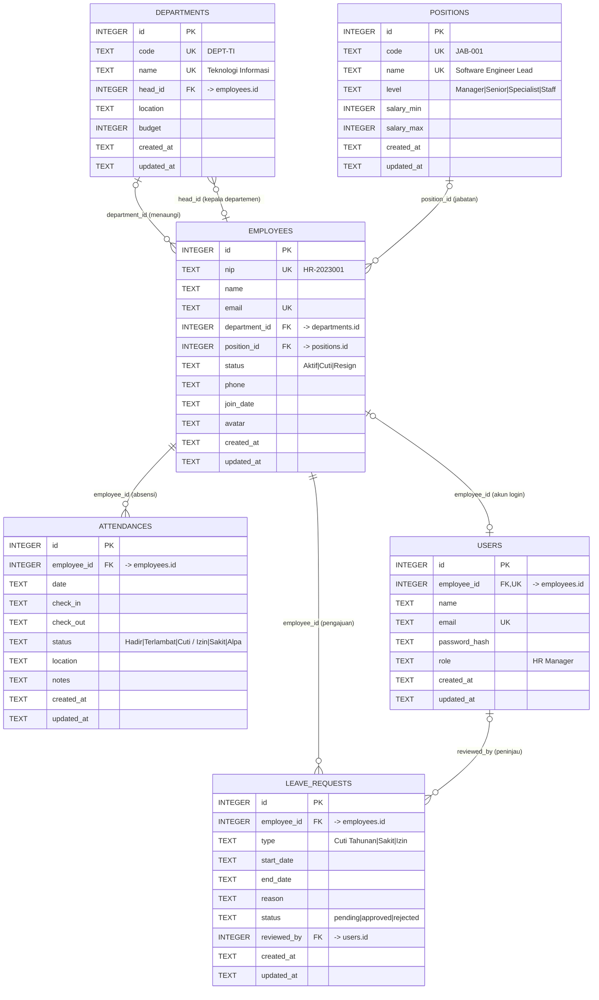

# ERD — Employee Management System (SDM Pro HRIS)

Dokumen ini mendeskripsikan **Entity Relationship Diagram** database SQLite
`employee_management.db` berdasarkan skema nyata di
`api/config/schema.php` dan hasil verifikasi langsung ke database
(`PRAGMA table_info`, `PRAGMA foreign_key_list`, `PRAGMA index_list`).

- **DBMS:** SQLite 3 (WAL mode, `PRAGMA foreign_keys = ON`)
- **Jumlah tabel domain:** 6 + 1 tabel internal (`app_meta`)
- **Sumber kebenaran skema:** `api/config/schema.php`
- **Lokasi DB:** `D:\Program\Laragon\storage\rdbms\employee_management.db` (di luar web root)

---

## 1. Ringkasan Relasi

| # | Dari | Ke | Kolom | Kardinalitas | ON DELETE |
|---|------|----|-------|--------------|-----------|
| 1 | `employees` | `departments` | `department_id` | N : 1 (opsional) | `SET NULL` |
| 2 | `employees` | `positions` | `position_id` | N : 1 (opsional) | `SET NULL` |
| 3 | `attendances` | `employees` | `employee_id` | N : 1 (wajib) | `CASCADE` |
| 4 | `leave_requests` | `employees` | `employee_id` | N : 1 (wajib) | `CASCADE` |
| 5 | `users` | `employees` | `employee_id` | 1 : 1 (opsional, UNIQUE) | `SET NULL` |
| 6 | `leave_requests` | `users` | `reviewed_by` | N : 1 (opsional) | `SET NULL` |
| 7 | `departments` | `employees` | `head_id` | N : 1 (opsional) | `SET NULL` |

> Relasi **#7** membuat `departments` ↔ `employees` saling mereferensi
> (circular reference): departemen punya kepala (karyawan), karyawan punya
> departemen. Ini sah di SQLite karena FK bersifat *deferred by default* dan
> kedua kolom nullable.

---

## 2. Diagram ERD (Mermaid)



---

## 3. Diagram Teks (fallback)

```
                     ┌────────────────────┐
                     │    DEPARTMENTS     │
                     │ id            (PK) │
                     │ code       (UNIQUE)│
                     │ name       (UNIQUE)│
                     │ head_id       (FK) ├──────────┐
                     └─────────┬──────────┘          │
                               │ 1                    │ kepala
                               │                      │ (0..N)
                               │ N                    │
┌────────────────────┐  ┌──────┴───────────────┐  ┌───┴──────────────┐
│     POSITIONS      │  │      EMPLOYEES       │  │      USERS       │
│ id             (PK)│1 │ id              (PK) │1 │ id          (PK) │
│ code       (UNIQUE)├─N│ department_id   (FK) ├─0│ employee_id (FK) │
│ name       (UNIQUE)│  │ position_id     (FK) │  │ email  (UNIQUE)  │
│ level              │  │ nip             (UK) │  │ role             │
│ salary_min/max     │  │ email           (UK) │  └───────┬──────────┘
└────────────────────┘  │ status               │          │ 1
                        └───┬──────────────┬───┘          │
                            │ 1            │ 1            │ N
                            │ N            │ N            │
                 ┌──────────┴───┐   ┌──────┴──────────┐   │
                 │ ATTENDANCES  │   │ LEAVE_REQUESTS  │   │
                 │ id       (PK)│   │ id          (PK)│   │
                 │ employee_id  │   │ employee_id (FK)│   │
                 │ date         │   │ reviewed_by (FK)├───┘
                 │ check_in/out │   │ status          │
                 │ status       │   │ type            │
                 └──────────────┘   └─────────────────┘
```

Keterangan: `1 ── N` = one-to-many, `1 ── 0` = one-to-zero-or-one (opsional).

---

## 4. Detail Tabel

### 4.1 `departments`

| Kolom | Tipe | Constraint | Keterangan |
|---|---|---|---|
| `id` | INTEGER | PK, AUTOINCREMENT | ID departemen |
| `code` | TEXT | NOT NULL, UNIQUE | Kode, mis. `DEPT-TI` |
| `name` | TEXT | NOT NULL, UNIQUE | Nama, mis. `Teknologi Informasi` |
| `head_id` | INTEGER | FK → `employees.id`, nullable | Kepala departemen |
| `location` | TEXT | nullable | Lokasi kerja |
| `budget` | INTEGER | NOT NULL, DEFAULT 0 | Anggaran |
| `created_at` | TEXT | NOT NULL, DEFAULT `datetime('now')` | — |
| `updated_at` | TEXT | nullable | — |

### 4.2 `positions`

| Kolom | Tipe | Constraint | Keterangan |
|---|---|---|---|
| `id` | INTEGER | PK, AUTOINCREMENT | ID jabatan |
| `code` | TEXT | NOT NULL, UNIQUE | Kode, mis. `JAB-001` |
| `name` | TEXT | NOT NULL, UNIQUE | Nama jabatan |
| `level` | TEXT | NOT NULL, CHECK | `Manager`, `Senior`, `Specialist`, `Staff` |
| `salary_min` | INTEGER | NOT NULL, DEFAULT 0 | Batas bawah gaji |
| `salary_max` | INTEGER | NOT NULL, DEFAULT 0 | Batas atas gaji |
| `created_at` | TEXT | NOT NULL, DEFAULT `datetime('now')` | — |
| `updated_at` | TEXT | nullable | — |

### 4.3 `employees` — tabel pusat

| Kolom | Tipe | Constraint | Keterangan |
|---|---|---|---|
| `id` | INTEGER | PK, AUTOINCREMENT | ID karyawan |
| `nip` | TEXT | NOT NULL, UNIQUE | Nomor induk pegawai |
| `name` | TEXT | NOT NULL | Nama lengkap |
| `email` | TEXT | NOT NULL, UNIQUE | Email |
| `department_id` | INTEGER | FK → `departments.id`, nullable | Departemen |
| `position_id` | INTEGER | FK → `positions.id`, nullable | Jabatan |
| `status` | TEXT | NOT NULL, DEFAULT `'Aktif'`, CHECK | `Aktif`, `Cuti`, `Resign` |
| `phone` | TEXT | nullable | Telepon |
| `join_date` | TEXT | NOT NULL | Tanggal bergabung |
| `avatar` | TEXT | nullable | URL avatar |
| `created_at` | TEXT | NOT NULL, DEFAULT `datetime('now')` | — |
| `updated_at` | TEXT | nullable | — |

### 4.4 `users` — akun login

| Kolom | Tipe | Constraint | Keterangan |
|---|---|---|---|
| `id` | INTEGER | PK, AUTOINCREMENT | ID user |
| `employee_id` | INTEGER | FK → `employees.id`, **UNIQUE**, nullable | 1 karyawan = 1 akun |
| `name` | TEXT | NOT NULL | Nama tampilan |
| `email` | TEXT | NOT NULL, UNIQUE | Email login |
| `password_hash` | TEXT | NOT NULL | Hash password |
| `role` | TEXT | NOT NULL, DEFAULT `'HR Manager'` | Peran |
| `created_at` | TEXT | NOT NULL, DEFAULT `datetime('now')` | — |
| `updated_at` | TEXT | nullable | — |

### 4.5 `attendances` — log absensi harian

| Kolom | Tipe | Constraint | Keterangan |
|---|---|---|---|
| `id` | INTEGER | PK, AUTOINCREMENT | ID absensi |
| `employee_id` | INTEGER | **NOT NULL**, FK → `employees.id` | Karyawan |
| `date` | TEXT | NOT NULL | Tanggal (`YYYY-MM-DD`) |
| `check_in` | TEXT | nullable | Jam masuk (`HH:MM`) |
| `check_out` | TEXT | nullable | Jam keluar (`HH:MM`) |
| `status` | TEXT | NOT NULL, DEFAULT `'Hadir'`, CHECK | `Hadir`, `Terlambat`, `Cuti / Izin`, `Sakit`, `Alpa` |
| `location` | TEXT | nullable | Lokasi / IP |
| `notes` | TEXT | nullable | Catatan |
| `created_at` | TEXT | NOT NULL, DEFAULT `datetime('now')` | — |
| `updated_at` | TEXT | nullable | — |

**UNIQUE (`employee_id`, `date`)** — satu karyawan hanya boleh punya **satu** baris absensi per tanggal.

### 4.6 `leave_requests` — pengajuan cuti/izin

| Kolom | Tipe | Constraint | Keterangan |
|---|---|---|---|
| `id` | INTEGER | PK, AUTOINCREMENT | ID pengajuan |
| `employee_id` | INTEGER | **NOT NULL**, FK → `employees.id` | Pemohon |
| `type` | TEXT | NOT NULL, CHECK | `Cuti Tahunan`, `Sakit`, `Izin` |
| `start_date` | TEXT | NOT NULL | Mulai |
| `end_date` | TEXT | NOT NULL | Selesai |
| `reason` | TEXT | nullable | Alasan |
| `status` | TEXT | NOT NULL, DEFAULT `'pending'`, CHECK | `pending`, `approved`, `rejected` |
| `reviewed_by` | INTEGER | FK → `users.id`, nullable | Peninjau |
| `created_at` | TEXT | NOT NULL, DEFAULT `datetime('now')` | — |
| `updated_at` | TEXT | nullable | — |

---

## 5. Aturan Referensial (ON DELETE)

| Relasi | Perilaku saat induk dihapus | Alasan |
|---|---|---|
| `attendances.employee_id` → `employees.id` | **CASCADE** | Log absensi tidak bermakna tanpa karyawan |
| `leave_requests.employee_id` → `employees.id` | **CASCADE** | Pengajuan ikut terhapus bersama karyawan |
| `employees.department_id` → `departments.id` | **SET NULL** | Karyawan tetap ada, departemen jadi kosong |
| `employees.position_id` → `positions.id` | **SET NULL** | Karyawan tetap ada, jabatan jadi kosong |
| `users.employee_id` → `employees.id` | **SET NULL** | Akun tetap ada (audit), tautan karyawan dilepas |
| `leave_requests.reviewed_by` → `users.id` | **SET NULL** | Riwayat pengajuan tetap ada |
| `departments.head_id` → `employees.id` | **SET NULL** | Departemen tetap ada tanpa kepala |

---

## 6. Index

| Index | Tabel | Kolom | Tujuan |
|---|---|---|---|
| `idx_employees_department` | `employees` | `department_id` | Filter per departemen |
| `idx_employees_position` | `employees` | `position_id` | Filter per jabatan |
| `idx_attendances_date` | `attendances` | `date` | Filter/urut tanggal |
| `idx_attendances_employee` | `attendances` | `employee_id` | Join & rekap per karyawan |
| `idx_leave_status` | `leave_requests` | `status` | Filter status pengajuan |
| `idx_leave_employee` | `leave_requests` | `employee_id` | Join per karyawan |

Index unik otomatis (dari constraint `UNIQUE`): `employees.nip`, `employees.email`,
`departments.code`, `departments.name`, `positions.code`, `positions.name`,
`users.email`, `users.employee_id`, serta komposit `attendances(employee_id, date)`.

---

## 7. Constraint Domain (CHECK)

| Tabel.Kolom | Nilai yang diizinkan |
|---|---|
| `employees.status` | `Aktif`, `Cuti`, `Resign` |
| `positions.level` | `Manager`, `Senior`, `Specialist`, `Staff` |
| `attendances.status` | `Hadir`, `Terlambat`, `Cuti / Izin`, `Sakit`, `Alpa` |
| `leave_requests.type` | `Cuti Tahunan`, `Sakit`, `Izin` |
| `leave_requests.status` | `pending`, `approved`, `rejected` |

---

## 8. Data Aktual (DB Utama, read-only)

| Tabel | Jumlah baris |
|---|---|
| `departments` | 6 |
| `positions` | 8 |
| `employees` | 10 |
| `users` | 1 |
| `attendances` | 54 |
| `leave_requests` | 4 |

**Keterisian relasi:**

| Relasi | Terisi / Total |
|---|---|
| `employees.department_id` | 10 / 10 |
| `employees.position_id` | 10 / 10 |
| `departments.head_id` | 6 / 6 |
| `users.employee_id` | 1 / 1 |
| `leave_requests.reviewed_by` | 3 / 4 (1 masih `NULL`) |

**Pemeriksaan integritas:**

```
integrity_check   = ok
foreign_key_check = 0 baris
orphan employees->departments = 0
orphan employees->positions   = 0
orphan attendances->employees = 0
orphan leave->employees       = 0
orphan leave->users           = 0
orphan users->employees       = 0
orphan departments->employees = 0
```

---

## 9. Contoh Query Join

**Karyawan lengkap dengan departemen & jabatan**

```sql
SELECT e.id, e.nip, e.name, e.status,
       d.name AS departemen,
       p.name AS jabatan
FROM employees e
LEFT JOIN departments d ON d.id = e.department_id
LEFT JOIN positions   p ON p.id = e.position_id
ORDER BY e.name;
```

**Log absensi + data karyawan**

```sql
SELECT a.date, e.nip, e.name,
       a.check_in, a.check_out, a.status
FROM attendances a
JOIN employees e ON e.id = a.employee_id
ORDER BY a.date DESC, a.id DESC;
```

**Pengajuan cuti + pemohon + peninjau**

```sql
SELECT l.id, e.name AS pemohon, l.type,
       l.start_date, l.end_date, l.status,
       u.name AS peninjau
FROM leave_requests l
JOIN employees e      ON e.id = l.employee_id
LEFT JOIN users u     ON u.id = l.reviewed_by
ORDER BY l.start_date DESC;
```

**Kepala tiap departemen**

```sql
SELECT d.name AS departemen, e.name AS kepala
FROM departments d
LEFT JOIN employees e ON e.id = d.head_id
ORDER BY d.name;
```

**Rekap kehadiran per karyawan**

```sql
SELECT e.name,
       SUM(a.status = 'Hadir')     AS hadir,
       SUM(a.status = 'Terlambat') AS terlambat,
       SUM(a.status = 'Sakit')     AS sakit,
       COUNT(*)                    AS total
FROM attendances a
JOIN employees e ON e.id = a.employee_id
GROUP BY e.id, e.name
ORDER BY total DESC;
```

---

## 10. Catatan Desain

1. **`employees` adalah pusat (hub).** Semua entitas transaksional
   (`attendances`, `leave_requests`) dan entitas akun (`users`) menunjuk ke sini.
2. **Soft state, bukan soft delete.** Karyawan yang tidak aktif ditandai lewat
   `employees.status = 'Resign'`, bukan dihapus, sehingga riwayat absensi/cuti
   tetap utuh.
3. **Circular reference yang disengaja.** `departments.head_id` ↔
   `employees.department_id` memungkinkan departemen dipimpin karyawan di
   departemen yang sama. Keduanya nullable dan `SET NULL`, jadi tidak ada
   deadlock saat penghapusan.
4. **Satu absensi per hari.** Dijamin oleh `UNIQUE (employee_id, date)`,
   sehingga `POST` kedua pada tanggal yang sama harus ditolak (409/422).
5. **Akun login bersifat opsional.** Tidak semua karyawan punya akun
   (`users.employee_id` nullable + UNIQUE); saat ini hanya 1 dari 10 karyawan
   yang punya akses.
6. **`leave_requests.reviewed_by` menunjuk ke `users`, bukan `employees`.**
   Jejak audit mengikuti akun yang benar-benar melakukan peninjauan.
7. **Tipe tanggal disimpan sebagai TEXT** (`YYYY-MM-DD` / `HH:MM`) agar
   kompatibel dengan SQLite dan mudah dipakai langsung oleh frontend.
